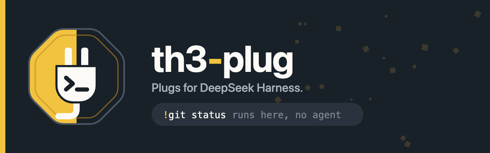
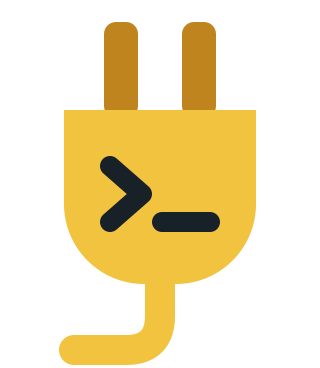

<p align="center">
  
</p>

<p align="center">
  <a href="LICENSE"></a>
  <a href="https://github.com/deepseek-ai/deepseek-harness"></a>
  
  
</p>

<p align="center">
  Small plugins ("plugs") you install into <a href="https://github.com/deepseek-ai/deepseek-harness">DeepSeek Harness</a> straight from a folder.<br>
  No build step, no dependencies: plain JavaScript, one folder per plug.
</p>

## Plugs

| | Plug | What it does |
|---|---|---|
|  | [**shell**](plugs/shell/README.md)<br>`@th3-plug/shell` | Run a command on your machine from the chat box with `!git status` or `/sh git status`. The AI agent is never called. zsh completions and shell history pop up while you type; the output comes back as a terminal block with the exit code and a Copy button. |

## Quick start

```bash
git clone https://github.com/th3r-dev/th3-plug.git
```

Then ask the agent in DeepSeek Harness, using the absolute path of your clone:

> install bundle /absolute/path/to/th3-plug/plugs/shell

Reload the window (Cmd+R) and type `!pwd`.

The profile links the folder, so it keeps reading from your clone. After a
`git pull` that changes a plug, remove and install it again, then reload the
window ([details](docs/dsh-notes.md#install-and-update)).

## Build a plug

```bash
npm run new -- my-plug --web --title "My plug"   # scaffold plugs/my-plug from the template
npm run check                                     # validate every plug before installing
npm test                                          # node:test for every plug
npm run verify                                    # check + test
```

`npm run new` gives you a working plug: a `/myplug` command on the Host side,
a chat card for it on the Web side, locale metadata, an icon and a test.
Replace the starter behaviour, keep the shape. [docs/dsh-notes.md](docs/dsh-notes.md)
lists the Harness APIs the existing plugs use and the traps worth knowing.

## Layout

```
th3-plug/
├─ plugs/<name>/            one Harness bundle per folder
│  ├─ package.json          @th3-plug/<name>, exports, dsh.bundle / dsh.client
│  ├─ cordis.patch.yml      the Loader row (id th3-<name>) and its default config
│  ├─ host/                 Host half: runs in the Harness process (Node)
│  ├─ web/client.js         Web half (optional): runs in the Harness page
│  ├─ locale/*.json         title and description in the plugin manager
│  ├─ icon.svg              plugin manager icon, in the brand's plug-icon family
│  ├─ test/*.test.mjs       node:test with a fake ctx, no dependencies
│  └─ README.md
├─ templates/plug/          what `npm run new` copies
├─ scripts/                 new-plug · check · render-brand
├─ brand/                   logo, icons, banner, colors — see brand/BRAND.md
└─ docs/dsh-notes.md        Harness APIs, install flow, traps
```

## Conventions

- Folder `plugs/<name>` ↔ package `@th3-plug/<name>` ↔ Loader row id `th3-<name>`.
- Tunable values live in the row's `config`, with defaults in `cordis.patch.yml`
  and every key documented in the plug README.
- Everything registers inside `apply` through `ctx.effect` / `ctx.on`, so
  removing a plug removes all of it.
- Inside the Harness UI, plugs use the Harness theme tokens (`--dsw-alias-*`);
  the [brand](brand/BRAND.md) colors are for icons, the repo and docs.
- Every plug ships a README, en + th locale metadata, an icon and tests;
  `npm run check` enforces the mechanical parts.

Working on this repo with a coding agent? It reads [AGENTS.md](AGENTS.md).

## Brand



The badge is the plug from the th3r-dev split octagon: gold on the left, ink
on the right, a shell prompt on the plug's face. Logo files, plug-icon rules,
colors and type are in [brand/BRAND.md](brand/BRAND.md); `npm run brand`
re-renders the PNGs from the SVG sources.

<br clear="left">

## License

MIT — see [LICENSE](LICENSE).
